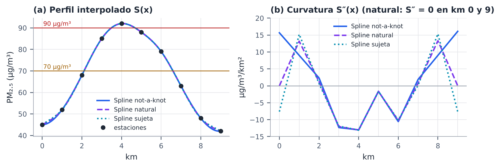
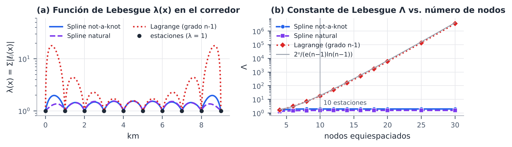
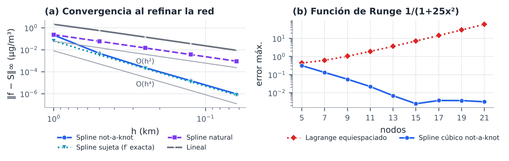
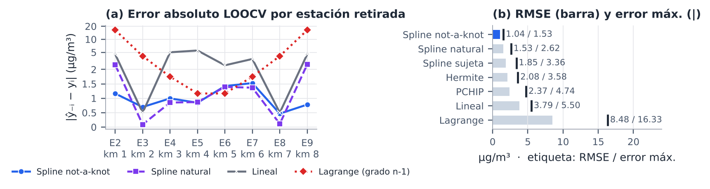
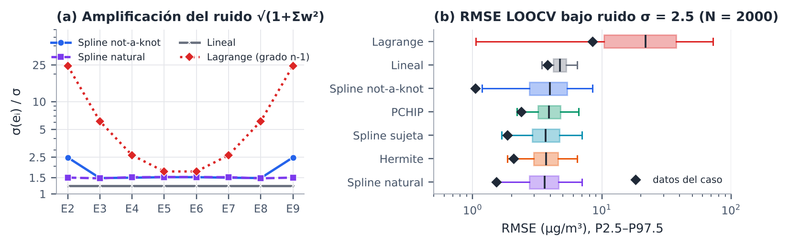

# Modelado y Validación — AirSpline (Estudio de Caso 3)

**Rol:** Ingeniero de Modelado y Validación — **Miguel Angel Laiton**
**Equipo:** Juan David Garrido (Algoritmos y Simulación) · Edwin Quiñones (Integración y Estrategia) · Miguel Angel Laiton (Modelado y Validación)
**Problema:** estimar PM₂.₅ cada 0.1 km (91 puntos) en un corredor de 9 km con 10 estaciones cada 1 km.

Este documento resume el trabajo del rol. Todos los números se generan con `modelado_validacion.py` y aparecen también en el cuaderno (§2, §2.4, §3, §3.1, §5 y §5.1) y en el informe IEEE [`docs/informe/informe_modelado_validacion.pdf`](informe/informe_modelado_validacion.pdf).

---

## Qué pide la guía y dónde está

| Tarea del rol (guía del laboratorio) | Dónde | Resultado clave |
|---|---|---|
| Formular el problema matemático | Cuaderno §2.1 · Informe §II | Sistema tridiagonal 8×8, κ₂ = 2.77 (natural) / 2.82 (*not-a-knot*) |
| Seleccionar y justificar la frontera (natural, sujeta, periódica) frente a lineal y Lagrange | Cuaderno §2.2 · Informe §III | **Not-a-knot**: sin hipótesis física, orden 4, menor RMSE LOOCV |
| Explicar por qué los splines evitan el fenómeno de Runge | Cuaderno §2.3–§2.4 · Informe §IV | Λ = 17.85 (Lagrange) frente a 1.97 (spline); orden observado 3.99 |
| Programar la validación cruzada *leave-one-out* en los 8 nodos internos | Cuaderno §5 · `loocv()` | Tabla de error absoluto por estación |
| Calcular RMSE y error máximo absoluto | Cuaderno §5 · `metricas()` | RMSE = **1.045** µg/m³, error máx. = **1.528** µg/m³ (E7) |
| *(extra)* Verificación del código | Cuaderno §3–§3.1 · `tests/` | Implementación propia = SciPy (Δ ≤ 1.4·10⁻¹⁴); 26 pruebas |
| *(extra)* Robustez de la validación ante el ruido de los sensores | Cuaderno §5.1 · Informe §VII | Factor de ruido ×2.48 en los bordes; alertas insensibles a la frontera (≤ 5 m) |

## Cómo reproducir

```bash
pip install -r requirements.txt
```

```bash
python modelado_validacion.py
```

```bash
python -m pytest -q tests
```

El primer comando imprime el reporte completo, regenera las figuras en `docs/informe/figuras/` y las tablas en `docs/informe/generado/` (CSV y macros LaTeX). El informe se compila con `pdflatex informe_modelado_validacion.tex` dentro de `docs/informe/` (o subiendo esa carpeta a Overleaf).

---

## 1. Formulación

En cada tramo `[x_i, x_{i+1}]`: `S_i(x) = a_i + b_i (x−x_i) + c_i (x−x_i)² + d_i (x−x_i)³`. Hay 36 incógnitas: 18 condiciones de interpolación, 16 de continuidad de S′ y S″ (clase C²) y 2 de frontera. Con `a_i = y_i` y `c_i = S″(x_i)/2` queda un sistema tridiagonal. Para el corredor (h = 1 km):

```
c_{i-1} + 4 c_i + c_{i+1} = 3 (y_{i+1} − 2 y_i + y_{i-1}),   i = 1 … 8
r = (27, 3, −30, −33, −15, −21, 3, 27)        (frontera natural, c_0 = c_9 = 0)
```

La matriz es estrictamente diagonal dominante (solución única, Thomas sin pivoteo en O(n)) y está muy bien condicionada (κ₂ = 2.77). En *not-a-knot* se eliminan `c_0 = 2c_1 − c_2` y `c_9 = 2c_8 − c_7`; las filas extremas quedan `6c_1 = r_1` y `6c_8 = r_8` (κ₂ = 2.82). El módulo implementa la forma general (mallas no uniformes) para las tres fronteras.

## 2. Selección de la condición de frontera

| Frontera | Hipótesis | ¿Tiene sentido en el corredor? | Orden observado | RMSE LOOCV |
|---|---|---|---|---|
| Natural | S″(0) = S″(9) = 0 | **No**: los datos indican S″(0) ≈ 15.7 y S″(9) ≈ 16.1 µg/m³/km² | 2.00 | 1.529 |
| Sujeta (`np.gradient`) | S′(0), S′(9) dadas | Las pendientes no se miden; la estimación unilateral O(h) degrada el orden e invierte la curvatura de borde (S″(0) = −7.6) | 2.02 (4.01 con f′ exacta) | 1.852 |
| **Not-a-knot** | S‴ continua en x₁ y x₈ | **Sí**: no impone nada físico, usa sólo los datos | **3.99** | **1.045** |
| Periódica | S(0) = S(9), S′ y S″ iguales | **No aplica**: corredor abierto y 45 ≠ 42 (el código lanza un error explicativo) | — | — |
| Lineal | — | C⁰, recorta los picos | 2.00 | 3.787 |
| Lagrange grado 9 | — | Inestable (fenómeno de Runge) | — | 8.483 |



## 3. Por qué el spline evita el fenómeno de Runge

- **Error de Lagrange:** `f − P₉ = f⁽¹⁰⁾(ξ)/10! · ω(x)`; con nodos equidistantes |ω| es **49×** mayor en el tramo [0,1] que en [4,5].
- **Estabilidad (constante de Lebesgue Λ):** un error δ en las lecturas produce como máximo Λ·δ en la curva. En los 10 nodos del corredor: **Lagrange 17.85** (cerca de km 0.32 y 8.68), *not-a-knot* 1.97, natural 1.54. Con 30 nodos Lagrange llega a 3.4·10⁶ y el spline sigue en 1.97.
- **Localidad:** la influencia de una estación decae ≈ 2 − √3 ≈ 0.27 por tramo (E5: 0.137 → 0.037 → 0.012). La función cardinal de Lagrange de E5 vale **4.03** en el tramo [0,1]: una perturbación en km 4 se amplifica en el borde.
- **Curvatura mínima** (teorema de Holladay) y **oscilaciones:** Lagrange tiene 4 extremos locales (los datos, 1) y un exceso de variación total de 4.28 µg/m³; el *not-a-knot*, 0.08 µg/m³.
- **Convergencia:** con pendientes exactas `‖f − S‖∞ ≤ (5/384) h⁴ ‖f⁽⁴⁾‖∞`. Observado: 3.99 (*not-a-knot*), 4.01 (sujeta exacta), 2.00 (natural y lineal). Con la función de Runge 1/(1+25x²), el error de Lagrange crece de 0.44 a 59.8 entre 5 y 21 nodos; el del spline baja a 0.0032.




## 4. Verificación del código

- Spline propio (formulación de la §1 + algoritmo de Thomas) para **natural, sujeta y not-a-knot**, comparado con `scipy.interpolate.CubicSpline` en la malla uniforme y en las 8 mallas no uniformes de la LOOCV: diferencia máxima de coeficientes **1.4·10⁻¹⁴**; todos los sistemas son estrictamente diagonal dominantes.
- Saltos de S, S′, S″ en los nodos internos ≤ 1.4·10⁻¹⁴ (clase C²); en *not-a-knot* el salto de S‴ en x₁ y x₈ es 0, como exige la condición.
- 26 pruebas automáticas en `tests/test_modelado_validacion.py` (Thomas, sistema del caso, igualdad con SciPy, C², orden de convergencia, Lebesgue, LOOCV del cuaderno, fórmula cerrada de la LOOCV lineal, factor de ruido analítico frente a Monte Carlo, tramos de alerta).

## 5. Validación cruzada *leave-one-out* (8 nodos internos)

Para cada estación interna E2…E9: se retira, se ajusta con las 9 restantes y se predice. `e_i = |ŷ₋ᵢ(x_i) − y_i|`, `RMSE = √(Σe_i²/8)`, `e_max = max e_i`. E1 y E10 no se retiran (sería extrapolar). Como cada predicción cruza un hueco de 2 km, la LOOCV es una estimación **conservadora** del error del modelo final.

**Error absoluto de predicción (µg/m³):**

| Estación | km | Real | Not-a-knot | Natural | Sujeta | Hermite | PCHIP | Lineal | Lagrange |
|---|---|---|---|---|---|---|---|---|---|
| E2 | 1 | 52 | 1.16 | 2.55 | 3.32 | 3.58 | 2.95 | 4.50 | 16.33 |
| E3 | 2 | 68 | 0.70 | 0.09 | 0.14 | 0.50 | 0.50 | 0.50 | 4.08 |
| E4 | 3 | 85 | 1.00 | 0.85 | 0.79 | 1.67 | 1.52 | 5.00 | 1.75 |
| E5 | 4 | 92 | 0.84 | 0.87 | 0.88 | 1.17 | 4.74 | 5.50 | 1.17 |
| E6 | 5 | 88 | 1.42 | 1.39 | 1.38 | 1.33 | 0.08 | 2.50 | 1.17 |
| E7 | 6 | 79 | 1.53 | 1.37 | 1.30 | 1.67 | 1.49 | 3.50 | 1.75 |
| E8 | 7 | 63 | 0.47 | 0.11 | 0.33 | 0.00 | 0.20 | 0.50 | 4.08 |
| E9 | 8 | 48 | 0.78 | 2.62 | 3.36 | 3.58 | 2.96 | 4.50 | 16.33 |
| **RMSE** | | | **1.045** | 1.529 | 1.852 | 2.080 | 2.366 | 3.787 | 8.483 |
| **MAE** | | | **0.987** | 1.232 | 1.438 | 1.688 | 1.805 | 3.312 | 5.833 |
| **Error máx.** | | | **1.528** | 2.621 | 3.362 | 3.583 | 4.740 | 5.500 | 16.333 |
| **Estación peor** | | | E7 | E9 | E9 | E2 | E5 | E5 | E2 / E9 |

**Conclusión:** el spline *not-a-knot* es el mejor en las tres métricas: **−72.4 % de RMSE frente a la lineal, −87.7 % frente a Lagrange y −31.7 % frente a la natural**. Las fronteras natural y sujeta fallan en E2/E9, justo donde actúa su hipótesis de borde.



## 6. Robustez de la validación ante el ruido (σ = 2.5 µg/m³)

Salvo PCHIP, los métodos son lineales en los datos: `e = M·y` con M de 8×10. Con ruido independiente N(0, σ²), la desviación del error LOOCV en la estación i es `σ·√(1 + Σ_j w_ij²)`:

| Método | E2 | E3 | E4 | E5 | E6 | E7 | E8 | E9 | RMS |
|---|---|---|---|---|---|---|---|---|---|
| Spline not-a-knot | 2.48 | 1.48 | 1.50 | 1.52 | 1.52 | 1.50 | 1.48 | 2.48 | 1.80 |
| Spline natural | 1.50 | 1.47 | 1.52 | 1.52 | 1.52 | 1.52 | 1.47 | 1.50 | 1.50 |
| Spline sujeta | 1.36 | 1.48 | 1.52 | 1.52 | 1.52 | 1.52 | 1.48 | 1.36 | 1.47 |
| Hermite (np.gradient) | 1.33 | 1.39 | 1.39 | 1.39 | 1.39 | 1.39 | 1.39 | 1.33 | 1.38 |
| Lineal | 1.22 | 1.22 | 1.22 | 1.22 | 1.22 | 1.22 | 1.22 | 1.22 | 1.22 |
| Lagrange (grado n-1) | 24.50 | 6.12 | 2.62 | 1.75 | 1.75 | 2.62 | 6.12 | 24.50 | 12.73 |

**LOOCV repetida con ruido** (2000 realizaciones, semilla 2024):

| Método | RMSE (datos del caso) | RMSE medio con ruido | P2.5 – P97.5 | % de veces el mejor |
|---|---|---|---|---|
| Spline natural | 1.529 | 3.78 | 1.50 – 7.02 | 16 % |
| Hermite (np.gradient) | 2.080 | 3.83 | 1.85 – 6.42 | 22 % |
| Spline sujeta | 1.852 | 3.87 | 1.67 – 6.99 | 9 % |
| PCHIP | 2.366 | 4.04 | 2.20 – 6.60 | 10 % |
| Spline not-a-knot | 1.045 | 4.17 | 1.18 – 8.46 | 31 % |
| Lineal | 3.787 | 4.78 | 3.43 – 6.44 | 5 % |
| Lagrange (grado n-1) | 8.483 | 25.99 | 1.05 – 72.68 | 6 % |

**Sensibilidad de las alertas al método:**

| Método | Amarilla (km) | Roja (km) | Desfase máx. vs not-a-knot |
|---|---|---|---|
| Spline not-a-knot | 2.11 – 6.59 | 3.49 – 4.68 | 0 m |
| Spline natural | 2.11 – 6.60 | 3.49 – 4.68 | 3 m |
| Spline sujeta | 2.11 – 6.60 | 3.49 – 4.68 | 5 m |
| Lagrange (grado n-1) | 2.11 – 6.62 | 3.47 – 4.68 | 30 m |
| Hermite (np.gradient) | 2.12 – 6.58 | 3.53 – 4.69 | 39 m |
| PCHIP | 2.12 – 6.59 | 3.53 – 4.64 | 45 m |
| Lineal | 2.12 – 6.56 | 3.71 – 4.50 | 226 m |

**Lectura:**
1. Con ruido fuerte los métodos cúbicos quedan estadísticamente empatados y ninguno domina; Lagrange y la lineal siguen siendo peores.
2. El *not-a-knot* amplifica más el ruido en los tramos de borde (factor 2.48 en E2/E9). Eso explica por qué la banda Monte Carlo de la §8 es más ancha cerca de los extremos: la réplica independiente da un ancho máximo de 11.23 µg/m³ en el km 8.4 y un mínimo de 6.93 en el km 4.4, igual que el cuaderno.
3. El RMSE observado (1.045) cae en el percentil 1.7 de su distribución con σ = 2.5: las lecturas del caso se comportan como promedios con un ruido efectivo ≲ 0.58 µg/m³. **σ = 2.5 es un escenario conservador**, que es lo deseable para alertas sanitarias.
4. Entre fronteras de spline, los límites de alerta cambian como máximo 5 m. Con una malla de 100 m, **la frontera no altera ninguna alerta**.



---

## 7. Entregables y hallazgos para el equipo

- **Para Edwin (Integración y Estrategia), KPIs del pitch:** continuidad C², RMSE LOOCV = 1.045 µg/m³, error máximo = 1.53 µg/m³, reducción de RMSE del 72.4 % frente a la lineal y del 87.7 % frente a Lagrange. Ante la pregunta *"¿qué pasa si falla una estación?"*, la respuesta es la LOOCV, que simula exactamente esa falla.
- **Para Juan David (Algoritmos y Simulación):** el modelo principal (`bc_type="not-a-knot"`) queda validado. La banda Monte Carlo de la §8 se reprodujo de forma independiente y su forma (más ancha en los bordes) queda explicada por el factor de amplificación.
- **Hallazgo de validación (corregido):** la búsqueda de tramos de alerta para los métodos sin `.solve` (Lineal y Lagrange en el panel §11 y en `airspline_app.py`) perdía las raíces que caen justo sobre un punto de la malla de búsqueda. Con la lineal y umbral 90 no se mostraba ninguna alerta roja, cuando debía marcar km 3.71–4.50; con umbral 71 se reportaba km 2.18–9.00 en lugar de 2.18–6.50. La corrección (2 líneas) está en la §7 del cuaderno, en `airspline_app.py` y en el módulo, con una prueba de regresión. El modelo principal no se veía afectado porque usa `CubicSpline.solve`.
- **Limitaciones:** modelo 1-D con 10 datos y 8 pliegues (métricas de alta varianza); no modela viento ni tráfico. Si el ruido real fuera del orden de σ = 2.5, el siguiente paso sería un spline de **suavizado** (`scipy.interpolate.make_smoothing_spline`, con parámetro elegido por validación cruzada generalizada) o kriging.

## 8. Preguntas probables del jurado sobre el rigor numérico

| Pregunta | Respuesta corta |
|---|---|
| ¿Por qué no Lagrange, si pasa por todos los puntos? | Su constante de Lebesgue es 17.85 con 10 estaciones y crece exponencialmente: el ruido se amplifica hasta 17.85× en los bordes. En la LOOCV comete errores de 16.3 µg/m³. |
| ¿Por qué *not-a-knot* y no natural? | La natural supone S″ = 0 en los extremos, pero los datos dan S″ ≈ 16. Por eso pierde precisión (orden 2 frente a 4) y su RMSE LOOCV es un 46 % mayor (1.529 frente a 1.045). |
| ¿Y la sujeta? | Necesita pendientes que no se miden; estimarlas con diferencias finitas degrada el orden a 2. |
| ¿La periódica? | Exige y₀ = y₉ y un dominio cerrado; el corredor es abierto y 45 ≠ 42. |
| ¿Cómo saben que el código está bien? | Implementamos el spline desde cero (Thomas) y coincide con SciPy a 10⁻¹⁴; además hay 26 pruebas automáticas y el orden de convergencia observado es el teórico. |
| ¿Qué tan confiable es el RMSE con sólo 8 pliegues? | Es una estimación de alta varianza y conservadora (hueco de 2 km). Por eso la complementamos con la LOOCV bajo ruido y con la sensibilidad de las alertas (≤ 5 m entre fronteras). |
| ¿Cambia la alerta si elegimos otra frontera? | No: los límites se mueven como máximo 5 m entre splines y la malla operativa es de 100 m. |

## Archivos del rol

| Archivo | Contenido |
|---|---|
| `modelado_validacion.py` | Módulo de V&V: spline propio (3 fronteras), LOOCV, métricas, Runge/Lebesgue, convergencia, robustez ante ruido, figuras y tablas |
| `tests/test_modelado_validacion.py` | 26 pruebas automáticas (`pytest`) |
| `docs/informe/informe_modelado_validacion.tex` / `.pdf` | Informe IEEE de 4 páginas del rol |
| `docs/informe/figuras/` | Figuras del informe y de este documento |
| `docs/informe/generado/` | Tablas CSV y macros LaTeX generadas (no editar a mano) |
| `AirSpline_Caso3.ipynb` §2, §2.4, §3, §3.1, §5, §5.1 | Secciones del rol dentro del cuaderno del equipo, sin dependencias externas (funcionan en Colab) |

## Referencias

1. R. L. Burden, J. D. Faires y A. M. Burden, *Análisis numérico*, 10.ª ed. Cengage Learning, 2017, cap. 3.
2. C. de Boor, *A Practical Guide to Splines*, ed. rev. Springer, 2001.
3. C. A. Hall y W. W. Meyer, "Optimal error bounds for cubic spline interpolation," *J. Approx. Theory*, vol. 16, no. 2, pp. 105–122, 1976.
4. L. N. Trefethen, *Approximation Theory and Approximation Practice*, ed. ampliada. SIAM, 2019.
5. C. Runge, "Über empirische Funktionen und die Interpolation zwischen äquidistanten Ordinaten," *Z. Math. Phys.*, vol. 46, pp. 224–243, 1901.
6. J. C. Holladay, "A smoothest curve approximation," *Math. Tables Aids Comput.*, vol. 11, no. 60, pp. 233–243, 1957.
7. T. Hastie, R. Tibshirani y J. Friedman, *The Elements of Statistical Learning*, 2.ª ed. Springer, 2009, cap. 7.
8. P. Virtanen *et al.*, "SciPy 1.0: Fundamental algorithms for scientific computing in Python," *Nat. Methods*, vol. 17, pp. 261–272, 2020.
